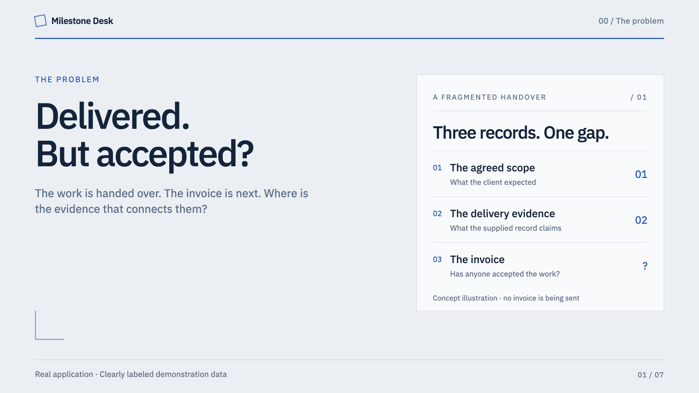

# Milestone Desk

**Proof before payment.** A private desk for freelancers and small studios to connect delivery evidence to an invoice.

[Watch the demo](https://youtu.be/_zXa-UIFpgg) · [Source code](https://github.com/imshkrsrvstv/milestone-desk) · [Run locally](#run) · [Download v1.0.1](https://github.com/imshkrsrvstv/milestone-desk/releases/tag/v1.0.1)

[](https://youtu.be/_zXa-UIFpgg)

Explore the [desktop overview](artifacts/gallery/overview-1440-light.png), [dark evidence review](artifacts/gallery/evidence-1440-dark.png), and [mobile view](artifacts/gallery/evidence-390-light.png). Source and demonstration are public; the Devpost entry is pending.

Milestone Desk turns a vague “the work is done” claim into a reviewable record. Each milestone has acceptance criteria, an amount, supplied evidence, AI suggestions with exact excerpts, and a human decision. Once every criterion is accepted, the app can create an **unsent PayPal sandbox draft invoice** for that fixed scope.

This is an original PayPal AI Hackathon project. It uses real AG Grid Community for the milestone comparison table and a configurable AI provider for evidence review.

## Run

Requires Node.js 22.13 or later. No package installation is needed.

```sh
node server.mjs
```

Open [Milestone Desk](http://127.0.0.1:4344/). The first launch creates a fictional three-milestone sample in the private `data/` directory. Core local review, human acceptance, and invoice preview work without credentials.

To connect the sandbox, copy `.env.example` to a private `.env`, fill the sandbox values, and run

```sh
node --env-file=.env server.mjs
```

The app accepts only `PAYPAL_SANDBOX_CLIENT_ID`, `PAYPAL_SANDBOX_CLIENT_SECRET`, and optional `PAYPAL_SANDBOX_MERCHANT_EMAIL`. Its PayPal host is fixed to `https://api-m.sandbox.paypal.com`. It has no invoice-send, capture, or production-payment endpoint.

AI review is optional. Configure an OpenAI-compatible chat-completions endpoint with `AI_BASE_URL` (ending in `/v1`), `AI_MODEL`, and server-only `AI_API_KEY` where required. `AI_FORMAT=json_schema` is the default; `json_object` is available for providers that do not support strict structured output. `MILESTONE_AI=off` disables AI while retaining manual review, human acceptance, and preview.

For a free local model, an operator can install Ollama, download a compatible model such as `qwen2.5:7b`, and set `AI_BASE_URL=http://127.0.0.1:11434/v1` and `AI_MODEL=qwen2.5:7b`. A loopback endpoint does not require an API key. The model download is approximately 4.7GB. See [Ollama’s local-compatible API](https://docs.ollama.com/api/openai-compatibility) and the [Qwen2.5:7b model page](https://ollama.com/library/qwen2.5:7b). This exact local model was verified through the real application adapter on 11 November 2026: it returned three supported, exact source excerpts for the fictional landing-page milestone in 17.443 seconds, with zero invented quotations and no acceptance decision changed. The private receipt is `data/local-model-verification.json`. This separate model-only check performed no invoice operation and does not change the provenance of the earlier saved demonstration. Model quality and speed vary; independent excerpt validation and explicit human acceptance still apply. Manual exploration requires neither a model nor payment credentials.

Requests are capped at eight per day and one at a time. A request contains only the selected milestone’s title, criteria, and evidence, never invoice recipients or payment credentials. The model has no tools. Exact excerpts are validated by application code outside the model. AI suggestions are always separate from human acceptance.

## Use the app

1. Choose the fictional sample or create a project with a client, sandbox recipient, currency, and first milestone. Add more milestones as needed.
2. Select a row in the AG Grid table. Sort amounts or use the search field to focus a deliverable.
3. Paste delivery notes, test logs, or other textual evidence and save it. Updating evidence clears previous analysis and acceptance.
4. Choose **Review with AI** or **Review myself**. AI describes whether the supplied text supports a criterion. It does not independently run tests. Unsupported or invented excerpts are discarded on the server.
5. Choose **Review each criterion**, record your reasoning, and accept delivery or request more work.
6. After every criterion is accepted, choose **Preview draft**. Inspect the recipient, amount, and exact PayPal payload. Confirm to create a sandbox draft.
7. Use **Check sandbox state** to retrieve the actual invoice again. Export a JSON review packet or expand the activity journal to explain the decisions.

The sample’s delivery claims and test acceptances are explicitly fictional. They are not customer validation or real project completion.

## Why the invoice stays safe

A milestone must have a saved review and an explicit human acceptance for every criterion. The server fingerprints its evidence and criteria. The invoice preview is hashed and checked again at creation. Only the server calculates the amount and recipient from that approved record.

SQLite reserves a unique attempt per milestone before the network call. Concurrent and repeated clicks return the same attempt. After a confirmed response, the app retrieves the invoice and checks its ID, number, milestone reference, recipient, currency, total, and `DRAFT` state.

A lost response is **uncertain**, not automatically retried. Reconciliation searches for the stable invoice number or retrieves the saved invoice ID. Only a definite PayPal rejection permits retrying the same payload. An invoice attempt locks the reviewed milestone against edits.

A draft is not a sent invoice or a payment. The app does not make legal or accounting determinations. The review is a practical delivery record.

## Project structure

```text
server.mjs                 Local HTTP app, origin checks, CSRF, invoice workflow
server/domain.mjs          Validation, fingerprints, evidence mapping, payloads
server/store.mjs           SQLite projects, review decisions, attempts, event log
server/ai.mjs               Bounded provider-neutral evidence reviewer
server/paypal.mjs          Sandbox OAuth, create/get/search invoice operations
web/                       Original interface and local static assets
web/vendor/                Pinned AG Grid Community bundle and MIT notice
tests/                     Domain, workflow, and browser tests
scripts/verify-live.mjs     Explicit real AI + sandbox integration verification
docs/                      Scope, dependency audit, submission materials
data/                      Private runtime data, excluded from source control
```

## Verification

```sh
npm test
PLAYWRIGHT_MODULE=/path/to/playwright/index.mjs node tests/browser.mjs
```

The browser check uses disposable local data and a clearly synthetic AI fixture. Set `SHOTS` to an output directory for screenshots. Set `AXE` to an installed `axe.min.js` to run an accessibility audit. Only the disposable test browser bypasses CSP so that audit library can run.

The explicit live check creates one unsent sandbox invoice and calls the real AI provider. Run it only when that sandbox action is intended

```sh
node --env-file=.env scripts/verify-live.mjs
```

Live verification was completed on 11 November 2026, India time. An actual AI review produced three valid exact-excerpt mappings. A PayPal sandbox draft was created, retrieved, reconciled, and returned unchanged on a duplicate create request. No invoice was sent. The private receipt is in `data/live-verification.json` on the development machine and is excluded from distributable source.

All 17 automated domain/provider checks and the full browser journey passed. Both themes, populated review and invoice dialogs, system preference, remembered appearance, keyboard operation and phone widths from 320px were checked. See `artifacts/design/design-qa.json` for the final results.

## ProofDeck integration and hosting

Assets and API requests use relative paths. ProofDeck can mount the app at `/lab/milestone/` while the service listens on loopback port 4344. The proxy must authenticate its caller, strip the prefix, normalize the upstream Host and Origin, and forward `X-Milestone-Token`. The app uses no session cookie. AG Grid requires inline styles, so only this app’s proxy pages allow `style-src 'self' 'unsafe-inline'`. Scripts and connections remain same-origin.

This release is a local single-owner app. Before exposing it publicly, add authenticated access and TLS at the proxy, define retention for project data, and keep the environment file private. The [2:09 narrated full-HD demo is public on YouTube](https://youtu.be/_zXa-UIFpgg), with a [downloadable copy in the GitHub release](https://github.com/imshkrsrvstv/milestone-desk/releases/download/v1.0.1/demo.mp4). Source and the verified free local setup are public. No hosted application is provided, and the Devpost entry is pending.

## Sources and licenses

- [PayPal draft-invoice API](https://developer.paypal.com/api/invoicing/v2/invoices-create)
- [PayPal invoicing quick start](https://developer.paypal.com/api/invoicing)
- [PayPal invoice API schema](https://developer.paypal.com/api/invoicing/v2/schema.json)
- [AG Grid JavaScript quick start](https://www.ag-grid.com/javascript-data-grid/getting-started/)
- [PayPal AI Hackathon rules](https://paypalaihackathon.devpost.com/rules)

AI-assisted development supported the research, application, tests and documentation. The running application uses AI to suggest evidence mappings; human acceptance and invoice approval remain separate actions.

Original application code is MIT licensed. AG Grid Community 36.3.0 is MIT licensed separately. Its pinned browser bundle was downloaded from the npm registry, integrity-verified against the package manifest, and inspected for install scripts and network behavior. No package install scripts were executed. See `docs/dependency-audit.json` and the bundled license. Google-font loading is explicitly disabled.

## Appearance

The visible theme control follows your system on first visit and remembers a light or dark choice. Connections offers a system reset. The evidence-dossier design covers the real comparison grid, native dialogs and the full review trail. See [the design rationale](docs/DESIGN.md).
