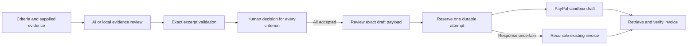

# How Milestone Desk works

The browser has no PayPal secret. It requests actions from the local server using a process-specific CSRF token. The server checks the Host, Origin, JSON request size, and action constraints. SQLite stores the project and invoice-attempt record before any invoice creation call.

AI output is a suggestion. Its criterion identifiers must exactly match the saved milestone. Claimed support requires an exact contiguous excerpt from the saved evidence. An incorrect excerpt becomes missing evidence. The human acceptance form is a separate action, with a note for every decision.

The model cannot call the invoice API. Invoice amount, currency, recipient, and milestone identity come from the stored project and its current acceptance fingerprint. An approved payload is hashed for preview confirmation, then reserved as a unique attempt. No sending or charging API is present.

If a request loses its response, the app cannot assume whether creation happened. It keeps the attempt locked and searches the sandbox for the stable invoice number. This prevents automatic duplicate creation. A definite provider rejection can be retried with the same payload.

The prototype intentionally omits tax calculations, multi-owner permissions, live payments, contract interpretation, binary upload parsing, and automatic proof of real-world completion. These are outside the implemented review-and-draft workflow.
